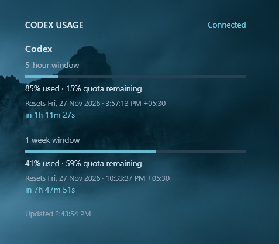
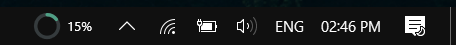
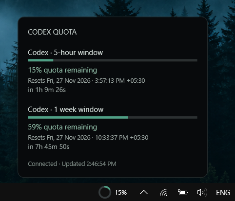
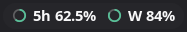
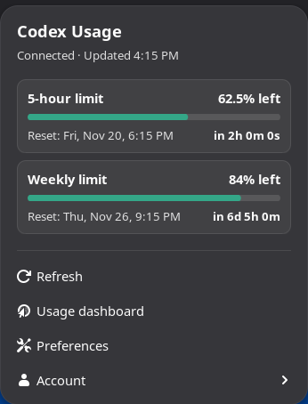

# Agent Usage

**See your remaining Codex quota and reset times on Windows and Linux.**

[Releases](https://github.com/kaveesha-neth/agent-usage/releases) · [Windows setup](#windows-setup) · [Linux setup](#linux-setup) · [Development](Source/README.md)

Agent Usage currently supports the official Codex CLI. Both applications appear as **Codex Usage** and reuse your ChatGPT sign-in. They read reported quota without making model requests or estimating message counts.

| Windows | Linux / GNOME |
| --- | --- |
| Desktop widget with quota bars, reset times, and countdowns. | Top-bar indicator with five-hour (`5h`) and weekly (`W`) quota rings. |
| Optional taskbar ring with hover details. | Click for quota bars, reset times, and countdowns. |
| Portable `CodexUsage.exe`; no separate .NET installation. | Archive with a GNOME extension, prebuilt helper, and per-user installer. |
| [Windows guide](Source/windows/README.md) | [Linux guide](Source/linux/README.md) |

## Screenshots

### Windows

<p align="center">
  <br>
  <br>
  
</p>

### Linux / GNOME

<p align="center">
  <br>
  <br>
  <em>GNOME screenshots use sample quota data.</em>
</p>

## Windows setup

**Requirements:** Windows 10 or 11, x64. For live data, install the official [Codex CLI](https://developers.openai.com/codex/cli) and sign in with a ChatGPT account. API-key billing does not provide the subscription quota shown here.

1. Download [CodexUsage.exe](https://github.com/kaveesha-neth/agent-usage/releases/latest/download/CodexUsage.exe) and save it in a permanent folder.
2. Run `CodexUsage.exe`. It is a portable, self-contained application; no installer or separate .NET runtime is needed. The executable is unsigned.
3. If sign-in is needed, open the tray icon and choose **Sign in with ChatGPT**. If Codex is not detected, open **Settings**, browse to the native `codex.exe`, save, quit from the tray, and relaunch.
4. Drag the desktop widget into position. Enable **Taskbar widget** in Settings if you also want the taskbar ring and hover details.

The Windows executable link is the intended release asset address. It will work after `CodexUsage.exe` is uploaded; the existing `v1.1.0` release contains Linux only. See [all releases](https://github.com/kaveesha-neth/agent-usage/releases) for available assets.

To try sample data without Codex, quit the widget and run this from its folder in PowerShell:

```powershell
.\CodexUsage.exe --mock
```

See the [Windows guide](Source/windows/README.md) for controls, upgrades, uninstall, troubleshooting, and building from source.

## Linux setup

**Requirements:** Ubuntu 26.04, GNOME Shell 50 on Wayland, x86-64. For live data, install the official [Codex CLI](https://developers.openai.com/codex/cli) and sign in with a ChatGPT account. API-key billing does not provide the subscription quota shown here.

1. Download [codex-usage-linux-x64.tar.gz](https://github.com/kaveesha-neth/agent-usage/releases/latest/download/codex-usage-linux-x64.tar.gz), rather than GitHub's automatically generated source archive.
2. Open a terminal in the download folder and run these commands as your regular desktop user:

   ```sh
   tar -xzf codex-usage-linux-x64.tar.gz
   cd codex-usage-linux-x64
   ./install.sh
   ```

3. Log out and back in if prompted. If the indicator is missing, open GNOME **Extensions** and enable **Codex Usage**.
4. If Codex is not detected, open the indicator's **Preferences** and set its executable path. To try sample data without Codex, enable **Demo mode** there.

The archive includes the GNOME extension and its prebuilt Go helper. Installation needs no `sudo`, Go, .NET, Node.js, or development tools.

See the [Linux guide](Source/linux/README.md) for controls, upgrades, uninstall, troubleshooting, and building from source.

## Privacy and data

Both applications read account and rate-limit data through the CLI's local app-server process. Sign-in, cancellation, and sign-out run only when selected. **Sign-out affects the shared Codex CLI session.** The transports block model turns, purchases, reset-credit consumption, API-key login, and email actions. The official usage dashboard opens only when selected; it is not scraped.

Local quota caches contain sanitized quota fields, a fetch time, and a one-way account fingerprint, rather than credentials or raw account payloads. Demo mode does not start the quota connection or read or write the live quota cache. Platform guides document storage locations and removal.

This is an unofficial project, not made or endorsed by OpenAI. See the [license](LICENSE), [.NET notices](Notices/), and the Go notices included in the Linux archive.

## Project documentation

- [Source layout and development](Source/README.md)
- [Release preparation](RELEASING.md)
- [Verification records](VERIFICATION.md)
- [Screenshot filenames and locations](docs/images/README.md)
